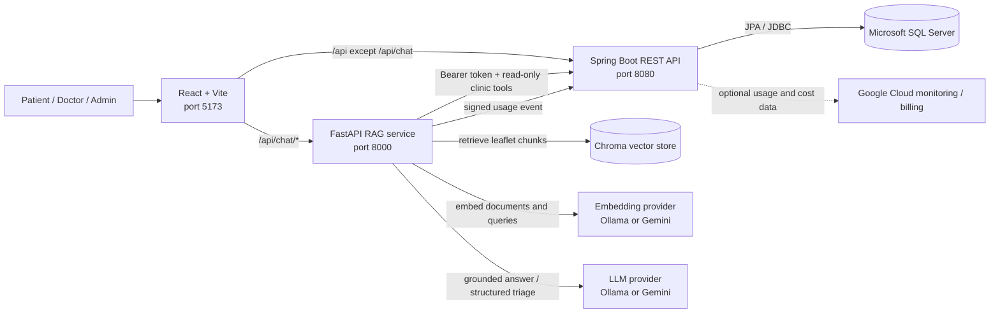

# Overall architecture

This diagram covers the deployable application, not only the chatbot. Solid
arrows are runtime requests; the dotted arrow is an optional telemetry export.

## Responsibilities and trust boundaries

| Component | Responsibility | Persistent data |
|---|---|---|
| React frontend | UI, client validation, auth token handling and streaming chat display | Browser session/local storage only |
| Spring Boot | Authentication/authorization, accounts, doctors, departments, schedules, appointments and AI telemetry | SQL Server |
| SQL Server | Transactional application data | Users, clinical directory, bookings and telemetry records |
| FastAPI RAG | Retrieval, prompt assembly, file extraction, tool orchestration, guardrails and structured-output validation | No uploaded file retention |
| Chroma | Vectors and metadata for the curated leaflet corpus | Local persistent vector index |
| Ollama/Gemini | Embedding and/or answer generation | Provider-dependent; uploaded text may leave the machine when Gemini is selected |

The browser sends ordinary application APIs to Spring Boot. Vite routes only
`/api/chat/*` to FastAPI. During symptom triage, FastAPI may forward the user's
bearer token to three allowlisted, read-only Spring endpoints for departments,
doctors and availability. That token is never included in an LLM prompt.

Authentication roles are signed into the JWT and converted to Spring Security
authorities by `JwtAuthenticationFilter`. Changes to a user's role therefore
take effect for newly issued tokens; existing tokens keep their claim until
expiry.

For upload chat, PDF/TXT text is extracted in memory, chunked, embedded and
used only for the current request. It is not added to the shared Chroma corpus.
The selected provider still receives the relevant text, which is why the UI and
documentation disclose whether generation is local or hosted.

