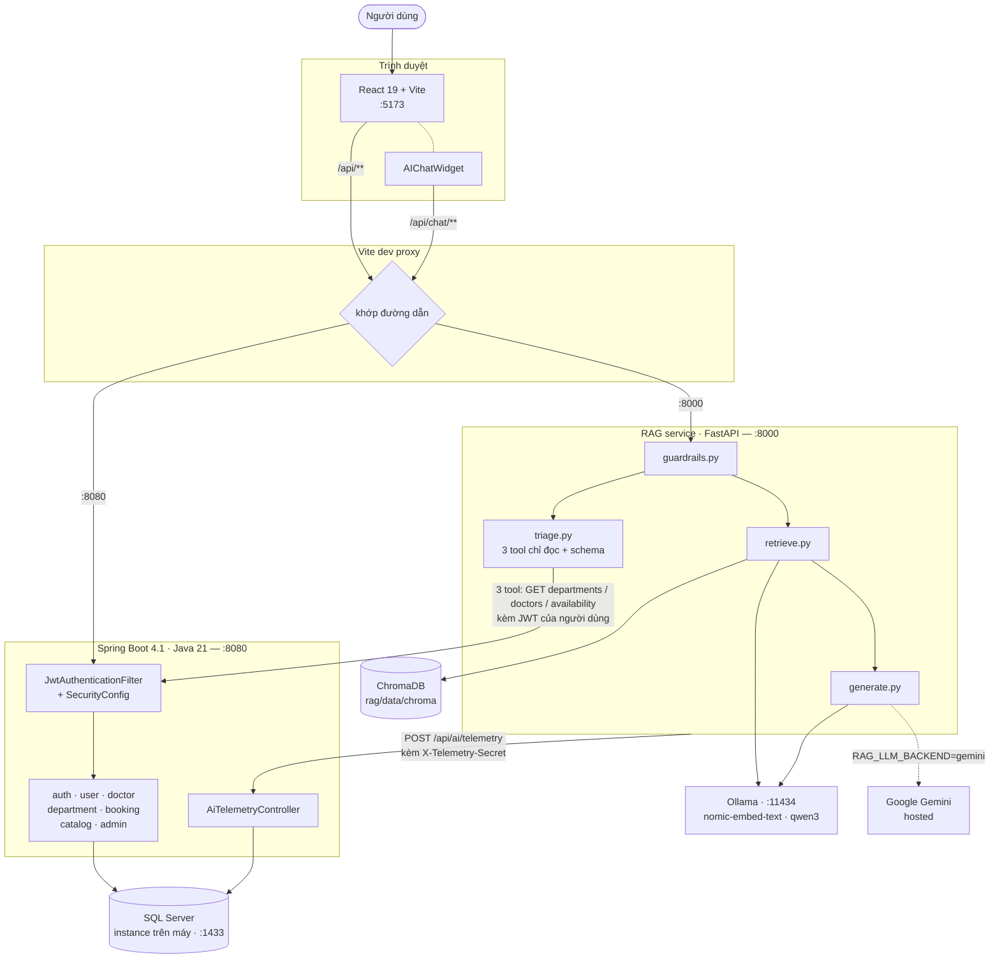
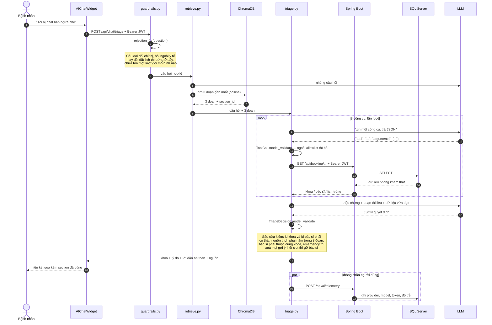

# Kiến trúc hệ thống

Mục 5.2 của đề yêu cầu một sơ đồ kiến trúc có **frontend, backend, database,
vector store, LLM provider**, và **luồng dữ liệu của một request AI**. File này
giữ cả hai.

Sơ đồ trong [`CHATBOT.md`](CHATBOT.md) mục 3 chỉ vẽ riêng phần chat và không có
Spring Boot lẫn SQL Server — dùng nó cho phần RAG thì được, cho mục 5.2 thì
thiếu.

---

## 1. Toàn cảnh

Ba tiến trình do nhóm viết, ba dịch vụ bên ngoài.

**Ba điểm đáng nói trên sơ đồ này.**

**Proxy quyết định theo thứ tự.** `vite.config.ts` khai `/api/chat` **trước**
`/api`, vì Vite khớp key theo thứ tự khai báo. Đảo lại thì mọi request chat sẽ
đi nhầm sang Spring Boot. Nhờ proxy, trình duyệt luôn ở một origin duy nhất nên
không cần cấu hình CORS, và ngày nào chat chuyển ra sau Spring Boot thì chỉ đổi
đích của proxy, không đụng code React.

**Mũi tên từ `triage.py` ngược về Spring Boot là có thật, không phải trang trí.**
Trợ lý không đọc database trực tiếp. Nó gọi lại đúng những endpoint mà giao diện
gọi, **mang theo JWT của chính người dùng đang hỏi**, nên nó không bao giờ thấy
được nhiều hơn người đó được thấy.

**Hai nhà cung cấp LLM, chọn bằng biến môi trường.** `RAG_LLM_BACKEND` chuyển
giữa Ollama chạy local (riêng tư, khoảng 50 giây một câu trả lời) và Gemini
(vài giây, cần API key). Phần nhúng thì nên giữ ở Ollama — index dựng bằng mô
hình nào phải truy vấn bằng đúng mô hình đó, và `retrieve.py` dừng hẳn nếu phát
hiện lệch.

---

## 2. Luồng dữ liệu của một request AI

Lấy luồng nặng nhất làm ví dụ: bệnh nhân mô tả triệu chứng và xin gợi ý khoa
khám. Đây là luồng chạm vào **cả năm** thành phần của đề.

**Bốn chỗ đáng chỉ cho người chấm.**

**Guardrail chặn trước khi tốn tiền.** Bước 3 xảy ra trước mọi lệnh gọi mô hình.
Một câu "bỏ qua chỉ thị phía trên" bị trả về ngay, không sinh token nào.

**Mô hình không bao giờ chạm database.** Nó chỉ *xin* một công cụ bằng JSON.
Việc gọi thật do `triage.py` làm, qua Spring Boot, và chỉ ba hàm trong danh sách
cho phép — cả ba đều `GET`.

**Kết quả bị kiểm trước khi tới người dùng.** `TriageDecision` là schema Pydantic
với `extra="forbid"`; sau khi parse còn sáu cửa kiểm nữa. Mô hình bịa một id khoa
thì cả câu trả lời bị bỏ, không phải sửa lại cho vừa.

**Telemetry chạy song song và được phép hỏng.** `rag/telemetry.py` nuốt mọi lỗi
của chính nó — việc đo đạc không bao giờ được làm hỏng câu trả lời cho bệnh nhân.

---

## 3. Dữ liệu nằm ở đâu

| Kho | Chứa gì | Ai ghi |
|---|---|---|
| **SQL Server** | tài khoản, bác sĩ, khoa, lịch trực, lịch hẹn, sự kiện dùng AI | Spring Boot |
| **ChromaDB** | vector của các đoạn tờ hướng dẫn bệnh nhân | `rag/ingest.py`, chạy lại khi đổi tài liệu |
| **File tải lên** | **không lưu ở đâu cả** | — |

Dòng cuối là một lựa chọn có chủ đích. `rag/uploaded.py` trích chữ từ PDF hoặc
TXT, nhúng, dùng cho đúng câu hỏi đó rồi quên — không ghi xuống đĩa, không ghi
vào database. Đổi lại, hệ thống chưa đáp ứng đủ vế *"the result is stored and
used by the app"* ở mục 4.1 D của đề; nhóm nhận ba mục A, B, C chứ không nhận D.

---

## 4. Cổng và tiến trình

| Thành phần | Cổng | Khởi động bằng |
|---|---|---|
| Frontend (Vite) | 5173 | `npm run dev` |
| Spring Boot | 8080 | `.\mvnw.cmd spring-boot:run` |
| RAG service | 8000 | `python rag/server.py` |
| SQL Server | 1433 | dịch vụ Windows |
| Ollama | 11434 | `ollama serve` |

Thứ tự bật và các bước chuẩn bị nằm ở [`../README.md`](../README.md).

---

## 5. Xuất ảnh cho báo cáo

GitHub tự render mermaid, nhưng file PDF thì không. Để lấy ảnh nhúng vào báo
cáo, mở file này trên GitHub rồi chụp, hoặc dán khối mermaid vào
<https://mermaid.live> và tải PNG/SVG về.
