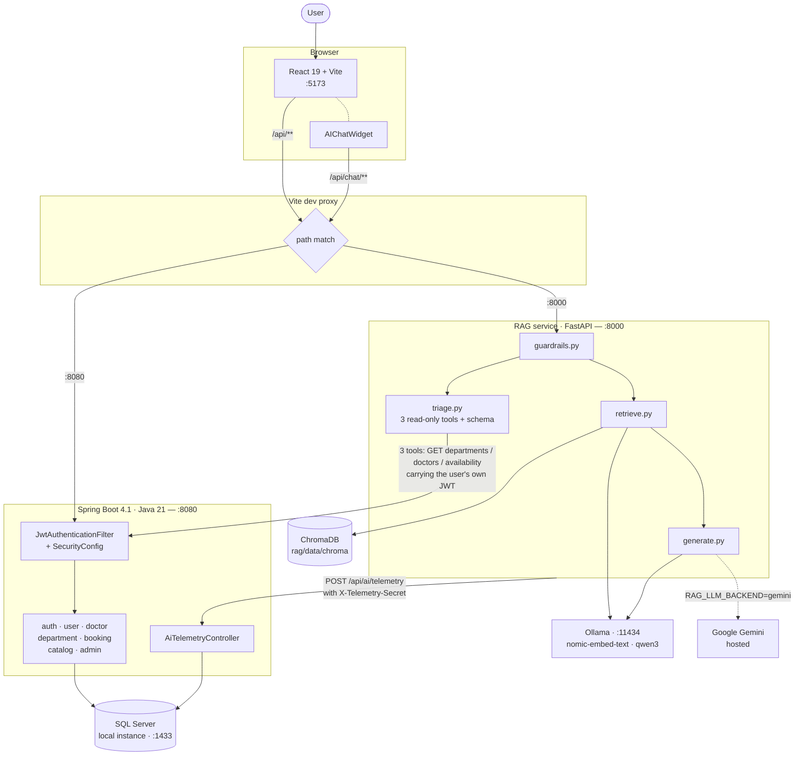
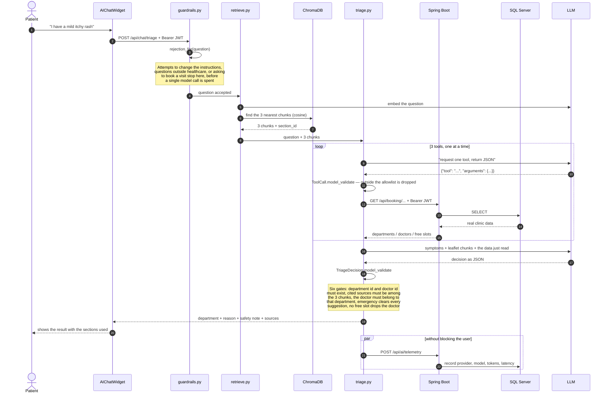

# System architecture

Section 5.2 of the brief asks for an architecture diagram containing
**frontend, backend, database, vector store and LLM provider**, plus **the data
flow of one AI request**. This file holds both.

The diagram in [`CHATBOT.md`](CHATBOT.md) section 3 covers only the chat path
and has neither Spring Boot nor SQL Server in it — fine for explaining the RAG
pipeline, not enough for section 5.2.

---

## 1. The whole system

Three processes written by the team, three external services.

**Three things worth pointing out on this diagram.**

**The proxy decides by order.** `vite.config.ts` declares `/api/chat`
**before** `/api`, because Vite matches keys in declaration order. Reverse them
and every chat request goes to Spring Boot instead. Thanks to the proxy the
browser stays on a single origin, so no CORS configuration is needed, and the
day chat moves behind Spring Boot only the proxy target changes, not the React
code.

**The arrow from `triage.py` back to Spring Boot is real, not decoration.**
The assistant does not read the database. It calls the same endpoints the
interface calls, **carrying the JWT of the very user asking**, so it can never
see more than that person is allowed to see.

**Two LLM providers, selected by an environment variable.**
`RAG_LLM_BACKEND` switches between Ollama running locally (private, around 50
seconds per answer) and Gemini (a few seconds, needs an API key). Embedding
should stay on Ollama — an index built with one model has to be queried with
that same model, and `retrieve.py` stops outright if it detects a mismatch.

---

## 2. The data flow of one AI request

Take the heaviest path as the example: a patient describes symptoms and asks
which department to visit. This path touches **all five** of the components the
brief asks about.

**Four things worth showing an examiner.**

**The guardrail blocks before anything is spent.** Step 3 happens before any
model call. A "ignore the instructions above" is rejected immediately, without
generating a single token.

**The model never touches the database.** It only *requests* a tool, as JSON.
The actual call is made by `triage.py`, through Spring Boot, and only the three
functions on the allowlist — all three of them `GET`.

**The result is checked before it reaches the user.** `TriageDecision` is a
Pydantic schema with `extra="forbid"`; after parsing there are six more gates.
If the model invents a department id the whole answer is dropped rather than
patched to fit.

**Telemetry runs alongside and is allowed to fail.** `rag/telemetry.py`
swallows its own errors — measuring must never break the answer a patient is
waiting for.

---

## 3. Where the data lives

| Store | Contents | Written by |
|---|---|---|
| **SQL Server** | accounts, doctors, departments, schedules, appointments, AI usage events | Spring Boot |
| **ChromaDB** | vectors of the patient-leaflet chunks | `rag/ingest.py`, rerun when documents change |
| **Uploaded files** | **not stored anywhere** | — |

The last row is a deliberate choice. `rag/uploaded.py` extracts text from a PDF
or TXT, embeds it, uses it for that one question and forgets it — nothing is
written to disk or to the database. The cost is that the system does not meet
the *"the result is stored and used by the app"* half of section 4.1 D of the
brief; the team claims A, B and C, not D.

---

## 4. Ports and processes

| Component | Port | Started by |
|---|---|---|
| Frontend (Vite) | 5173 | `npm run dev` |
| Spring Boot | 8080 | `.\mvnw.cmd spring-boot:run` |
| RAG service | 8000 | `python rag/server.py` |
| SQL Server | 1433 | Windows service |
| Ollama | 11434 | `ollama serve` |

Start-up order and the preparation steps are in
[`../README.md`](../README.md).

---

## 5. Exporting the figures

GitHub renders mermaid directly, but a PDF does not. The project report embeds
both diagrams as vector graphics: `docs/report/figures/*.svg` are the rendered
copies, and `docs/report/build_report.py` places them in the PDF. To refresh
them after editing the mermaid above, re-render and overwrite those two files.
For a quick one-off, paste a block into <https://mermaid.live> and download the
PNG or SVG.
