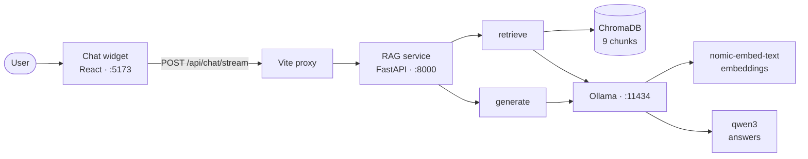

# The Chatbot: how it works

*Bản tiếng Việt: [CHATBOT.vi.md](CHATBOT.vi.md)*

This explains the AI chat assistant end to end - the idea, the moving parts, and
how to change it safely. It assumes no prior knowledge of RAG.

For measurements, evaluation scores and open issues, see [`rag/README.md`](../rag/README.md).
That file is the working log; this one is the explanation.

---

## 1. What it is

The chat widget answers questions about the hospital's patient information
leaflets. It does **not** answer from the language model's own knowledge. Every
answer is built from text retrieved out of a real document, and the widget shows
which sections were used.

This matters because the alternative is a model that invents plausible medical
information. A model asked "how many puffs during an asthma attack?" will always
produce *an* answer. The point of this system is that the answer comes from the
leaflet, and you can check it.

### What it can and cannot do today

| Can | Cannot |
|---|---|
| Answer questions about asthma, in English | Answer in Vietnamese (the embedding model is English-only) |
| Say "I don't know" when the documents don't cover something | Book appointments, look up doctors, or answer about opening hours |
| Show which section each answer came from | Remember earlier messages in the conversation |

The corpus is currently **one** document: a 4-page NHS asthma leaflet. Anything
outside it gets refused. That refusal is correct behaviour, not a bug - but it is
also why the corpus needs to grow before this is useful to real visitors.

---

## 2. The idea: retrieval-augmented generation

A language model does not know your documents. There are three ways to fix that:
retrain it (expensive, and it still invents things), paste every document into
every request (blows past the context limit and costs a fortune), or **find the
few relevant paragraphs first and paste only those**. The third is RAG.

The useful mental model: turn every question into an *open-book exam*. Instead of
asking the model to remember, hand it the right page.

RAG is two separate pipelines that run at different times. Confusing them is the
most common source of bugs.

### Phase A - Indexing (offline, run once per document change)

```
PDF  →  extract text  →  strip page furniture  →  split into sections
     →  turn each section into a vector  →  store in a vector database
```

Run with `python rag/ingest.py`. You re-run it when documents change, not when
questions are asked.

### Phase B - Querying (online, every question)

```
question  →  turn into a vector  →  find the nearest sections
          →  paste them into a prompt  →  language model writes the answer
```

**The same embedding model must be used in both phases.** If you change it in one
place and not the other, the system keeps working but returns nonsense, with no
error message. This is the single biggest trap in RAG.

---

## 3. Architecture

Three processes talk to each other:



**Why the proxy.** The browser calls the relative path `/api/chat/stream`. Vite
forwards it to port 8000. Two benefits: the browser stays on one origin, so no
CORS configuration is needed; and when Spring Boot eventually takes over this
route, only the proxy target changes - no React code is touched. That is also why
the Python service mounts its routes under `/api/chat` rather than `/chat`.

---

## 4. The files

Read them in this order; each is short.

| File | What it does |
|---|---|
| `rag/config.py` | **Start here.** Every tunable parameter, each with a comment saying why it has that value |
| `rag/ollama_api.py` | Talks to Ollama: `embed()` for vectors, `chat()` / `chat_stream()` for answers |
| `rag/ingest.py` | Phase A. PDF → 9 chunks → vectors → ChromaDB |
| `rag/retrieve.py` | Phase B step 1. Question → nearest chunks, with similarity scores |
| `rag/generate.py` | Phase B step 2. Chunks + question → prompt → answer |
| `rag/server.py` | HTTP wrapper. `POST /api/chat`, `POST /api/chat/stream`, `GET /api/chat/health` |
| `rag/ask.py` | Command-line version, useful for debugging - it prints the retrieved chunks *and* their scores |
| `rag/evaluate.py` | Scores the system against a fixed question set |
| `rag/eval/eval_questions.yaml` | 34 test questions with the correct answer source for each |
| `frontend/src/services/chatApi.ts` | Browser-side client, including the streaming reader |
| `frontend/src/components/AIChatWidget.tsx` | The widget UI |

`server.py` deliberately contains no retrieval or prompting logic of its own. It
calls the same functions `evaluate.py` scores, so **what is served is what was
measured**. Any behaviour change has to go through `config.py`, where the next
evaluation run will catch it.

---

## 5. One question, start to finish

Question: *"My son was born six weeks early. Does that make asthma more likely?"*

1. **Embed the question.** `retrieve.py` sends it to `nomic-embed-text`, prefixed
   with `search_query: `, and gets back 768 numbers.
2. **Search.** ChromaDB compares that vector against the 9 stored chunk vectors
   by cosine similarity and returns the closest 3. Top hit:
   `why-people-get-asthma`.
3. **Build the prompt.** `generate.py` pastes those 3 chunks under a system
   prompt that says: answer only from these documents, say so if they don't
   cover it, never invent a dose, cite the section.
4. **Generate.** `qwen3` writes: *"Yes, premature birth is listed as a risk
   factor for asthma. (section: why-people-get-asthma)"*
5. **Display.** The widget shows the answer plus a chip for each source section.

The leaflet says *"Premature birth or low birth weight are thought to be risk
factors"*. Note that the question never used the words "premature" or "risk
factor". Keyword search would have missed it entirely; the embedding matched on
meaning. That is the whole reason vectors are involved.

---

## 6. Running it

Two processes, two terminals, from the repository root:

```bash
python rag/server.py                 # RAG service, port 8000
npm run dev --prefix frontend        # web app, port 5173
```

Then open **http://localhost:5173** and click the chat bubble. The header shows
`Online` when the service is reachable and `Offline` when it is not.

First-time setup:

```bash
pip install -r rag/requirements.txt
ollama pull nomic-embed-text
ollama pull qwen3
python rag/ingest.py
```

`ingest.py` only needs re-running when documents change.

To ask a question without the browser:

```bash
python rag/ask.py "What are the signs of asthma?"
python rag/ask.py --no-llm "..."     # retrieval only, instant
```

`--no-llm` is the fastest way to check *"did it find the right section?"*, which
is the first question to ask whenever an answer looks wrong.

---

## 7. Adding a document

1. Put the PDF in `rag/data/raw/`.
2. Teach `ingest.py` where its sections start: add entries to `SECTION_HEADINGS`
   in `config.py`. The current list is hand-written for the asthma leaflet, so a
   second document needs its own headings - or a general heading detector, which
   is the better fix once there are several documents.
3. Run `python rag/ingest.py` and check the printed chunk table looks sensible.
4. Add a few questions for the new document to `eval/eval_questions.yaml`.
5. Run `python rag/evaluate.py` and compare against the previous score.

Step 4 is the one people skip. Without it, the new document is untested and the
overall score silently stops meaning anything.

---

## 8. Changing things without breaking them

The evaluation set exists so that "this is better now" is a measurement rather
than a feeling. The workflow:

```bash
python rag/evaluate.py               # retrieval only - fast
python rag/evaluate.py --generate    # with answers - slow (~30 min)
```

Change **one thing**, re-run, compare with the previous file in
`rag/eval/results/`. Each result file records the config that produced it.

Two lessons already paid for, both documented in `rag/README.md`:

- **Prompts are a noisy lever.** Adding a single rule to the system prompt
  changed the text of 26 out of 34 answers - fixing one, breaking another, and
  missing the problem it was written for. Never judge a prompt change by the one
  question that motivated it.
- **Two examples are not evidence.** The decision to disable the model's
  reasoning mode was made from a 2-question probe where the answers looked
  identical and it ran 5x faster. The full 30-question set later showed it was
  dropping "call for an ambulance" from the asthma-attack instructions.

---

## 9. Design decisions worth knowing

**Embedding prefixes are mandatory.** `nomic-embed-text` expects
`search_document: ` on stored text and `search_query: ` on questions. Omitting
them degrades ranking silently - no error, just worse answers. Measured: dropping
them moved one test question to the wrong section.

**There is no similarity threshold.** The obvious design is "if the best score is
too low, say I don't know". It does not work here: an unanswerable question
scored 0.596 while an answerable one scored 0.606 on its correct section. The
ranges overlap, so no cut-off can separate them. Refusal is enforced by the
system prompt instead, and verified by the `refusal` group in the evaluation set.

**Chunks follow headings, not a fixed size.** The leaflet's asthma-attack section
is a 4-step emergency procedure. A fixed-size splitter would cut it in half, and
retrieval would happily return "take up to 10 puffs" without "then call an
ambulance". Chunking by heading keeps each instruction set whole.

**Ground truth points at section names, not chunk numbers.** The evaluation file
says "the answer should come from `asthma-attack`", never "chunk 8". This means
the test set survives a change of chunking strategy.

**The model's raw reasoning is never shown to the user.** With reasoning enabled,
it streams back before the answer and would fill the wait nicely. It is also
unedited working-out that can contain half-formed medical claims. The widget uses
only the *fact* that reasoning started, to update its status label.

**Answers stream.** With reasoning on, the first answer word is about 40 seconds
away. Rather than choose between a fast-but-incomplete answer and a silent
minute, the service streams: sources appear at ~5s, a status label at ~13s, and
the answer is written out from ~40s. The total time is unchanged; the wait is
just no longer blank.

---

## 10. Limits and open issues

Summarised from `rag/README.md`, which has the details:

- **One document.** Nine chunks. The evaluation scores are therefore soft - with
  `k=3` the system retrieves a third of the entire corpus on every question.
- **~50 seconds per answer.** Tolerable with streaming, still slow. A smaller
  model is the next thing to try.
- **Abandoned requests keep running.** If someone reloads mid-question, the work
  continues and the next person queues behind it.
- **No rate limiting.** One user can occupy the single generation slot. This
  belongs with the Spring Boot layer.
- **Not behind the backend yet.** The chat endpoint is currently served directly
  by the Python service through the dev proxy. Moving it behind Spring Boot -
  with authentication and rate limiting - is the next phase.

---

## 11. Glossary

| Term | Plain meaning |
|---|---|
| **Chunk** | One piece of a document, here one section under a heading |
| **Embedding** | A list of 768 numbers representing a piece of text's meaning |
| **Vector store** | A database that finds the stored text whose numbers are closest to a query's numbers |
| **Cosine similarity** | How close two embeddings are, from -1 to 1. Higher is more similar |
| **Top-k** | How many chunks to retrieve. Here, 3 |
| **recall@k** | Share of test questions where the correct section appears in the top k results |
| **Grounding** | Answering only from supplied text rather than from the model's own memory |
| **Hallucination** | A confident answer the model invented. What this whole design exists to prevent |
