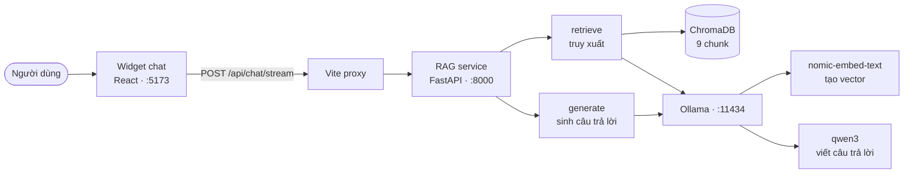

# Chatbot hoạt động như thế nào

*English version: [CHATBOT.md](CHATBOT.md)*

Tài liệu này giải thích trợ lý chat AI từ đầu đến cuối — ý tưởng, các thành phần,
và cách sửa đổi an toàn. Không giả định bạn đã biết RAG là gì.

Về số đo, điểm đánh giá và các vấn đề còn tồn đọng, xem [`rag/README.md`](../rag/README.md).
File đó là *nhật ký công việc*; file này là *phần giải thích*.

---

## 1. Nó là cái gì

Widget chat trả lời câu hỏi dựa trên các tờ thông tin y tế dành cho bệnh nhân. Nó
**không** trả lời bằng kiến thức sẵn có của mô hình ngôn ngữ. Mọi câu trả lời đều
được dựng từ đoạn văn bản lấy ra từ tài liệu thật, và widget hiện rõ nó đã dùng
mục nào.

Điều này quan trọng, vì phương án còn lại là một mô hình bịa ra thông tin y tế
nghe rất hợp lý. Hỏi một mô hình "lên cơn hen thì xịt mấy nhát?" thì bao giờ nó
cũng sinh ra *một* câu trả lời. Mục đích của hệ thống này là câu trả lời phải đến
từ tờ thông tin, và bạn kiểm chứng được.

### Hiện tại làm được gì, chưa làm được gì

| Làm được | Chưa làm được |
|---|---|
| Trả lời về bệnh hen suyễn, bằng tiếng Anh | Trả lời tiếng Việt (model embedding chỉ hỗ trợ tiếng Anh) |
| Nói "tôi không biết" khi tài liệu không đề cập | Đặt lịch khám, tra cứu bác sĩ, trả lời giờ mở cửa |
| Hiện rõ mỗi câu trả lời lấy từ mục nào | Nhớ các tin nhắn trước đó trong cuộc hội thoại |

Kho tài liệu hiện có **một** file: tờ thông tin về hen suyễn của NHS, 4 trang. Hỏi
ngoài phạm vi đó sẽ bị từ chối. Việc từ chối là **hành vi đúng**, không phải lỗi —
nhưng cũng chính là lý do kho tài liệu cần được mở rộng trước khi hệ thống này thực
sự hữu ích với người dùng thật.

---

## 2. Ý tưởng: retrieval-augmented generation

Mô hình ngôn ngữ không biết gì về tài liệu của bạn. Có ba cách khắc phục: huấn
luyện lại nó (đắt, mà vẫn bịa), dán toàn bộ tài liệu vào mỗi request (vượt giới
hạn ngữ cảnh và tốn kinh khủng), hoặc **tìm ra vài đoạn liên quan trước rồi chỉ
dán những đoạn đó**. Cách thứ ba chính là RAG.

Cách hình dung hữu ích: biến mọi câu hỏi thành một **bài thi mở sách**. Thay vì bắt
mô hình phải nhớ, ta đưa cho nó đúng trang cần đọc.

RAG gồm **hai pipeline riêng biệt, chạy ở hai thời điểm khác nhau**. Nhầm lẫn giữa
hai pha này là nguồn gốc lỗi phổ biến nhất.

### Pha A — Indexing (offline, chạy lại mỗi khi tài liệu thay đổi)

```
PDF  →  rút text  →  xoá phần thừa lặp lại  →  cắt thành từng mục
     →  biến mỗi mục thành vector  →  lưu vào vector database
```

Chạy bằng `python rag/ingest.py`. Chỉ chạy lại khi tài liệu đổi, **không** chạy
mỗi lần có câu hỏi.

### Pha B — Querying (online, mỗi lần có câu hỏi)

```
câu hỏi  →  biến thành vector  →  tìm các mục gần nhất
         →  dán vào prompt  →  mô hình ngôn ngữ viết câu trả lời
```

**Phải dùng cùng một model embedding ở cả hai pha.** Nếu đổi ở một chỗ mà quên chỗ
kia, hệ thống vẫn chạy bình thường nhưng trả về kết quả rác, **không hề báo lỗi**.
Đây là cái bẫy lớn nhất trong RAG.

---

## 3. Kiến trúc

Ba tiến trình nói chuyện với nhau:



**Vì sao cần proxy.** Trình duyệt gọi đường dẫn tương đối `/api/chat/stream`. Vite
chuyển tiếp sang cổng 8000. Hai lợi ích: trình duyệt ở cùng một origin nên **không
cần cấu hình CORS**; và sau này khi Spring Boot tiếp quản route này, **chỉ cần đổi
target của proxy** — không đụng một dòng React nào. Đó cũng là lý do service Python
đặt route dưới `/api/chat` chứ không phải `/chat`.

---

## 4. Các file

Đọc theo thứ tự này, mỗi file đều ngắn.

| File | Làm gì |
|---|---|
| `rag/config.py` | **Bắt đầu từ đây.** Mọi tham số điều chỉnh được, mỗi cái kèm chú thích vì sao chọn giá trị đó |
| `rag/ollama_api.py` | Nói chuyện với Ollama: `embed()` tạo vector, `chat()` / `chat_stream()` sinh câu trả lời |
| `rag/ingest.py` | Pha A. PDF → 9 chunk → vector → ChromaDB |
| `rag/retrieve.py` | Pha B bước 1. Câu hỏi → các chunk gần nhất, kèm điểm similarity |
| `rag/generate.py` | Pha B bước 2. Chunk + câu hỏi → prompt → câu trả lời |
| `rag/server.py` | Lớp HTTP. `POST /api/chat`, `POST /api/chat/stream`, `GET /api/chat/health` |
| `rag/ask.py` | Bản dòng lệnh, rất hữu ích để gỡ lỗi — nó in ra **cả** các chunk lấy được **lẫn** điểm số |
| `rag/evaluate.py` | Chấm điểm hệ thống trên bộ câu hỏi cố định |
| `rag/eval/eval_questions.yaml` | 34 câu hỏi kiểm tra, kèm nguồn đúng cho từng câu |
| `frontend/src/services/chatApi.ts` | Client phía trình duyệt, gồm cả bộ đọc streaming |
| `frontend/src/components/AIChatWidget.tsx` | Giao diện widget |

`server.py` **cố tình không chứa** logic truy xuất hay prompt riêng. Nó gọi đúng
những hàm mà `evaluate.py` chấm điểm, nên **thứ được phục vụ chính là thứ đã được
đo**. Mọi thay đổi hành vi đều phải đi qua `config.py`, nơi lần chấm điểm kế tiếp
sẽ phát hiện ra.

---

## 5. Một câu hỏi, từ đầu đến cuối

Câu hỏi: *"My son was born six weeks early. Does that make asthma more likely?"*

1. **Biến câu hỏi thành vector.** `retrieve.py` gửi nó tới `nomic-embed-text`, kèm
   tiền tố `search_query: `, nhận về 768 con số.
2. **Tìm kiếm.** ChromaDB so vector đó với 9 vector chunk đã lưu bằng cosine
   similarity, trả về 3 cái gần nhất. Hạng 1: `why-people-get-asthma`.
3. **Dựng prompt.** `generate.py` dán 3 chunk đó dưới một system prompt nói rằng:
   chỉ trả lời từ tài liệu này, không có thì nói là không có, tuyệt đối không bịa
   liều thuốc, và phải dẫn nguồn.
4. **Sinh câu trả lời.** `qwen3` viết: *"Yes, premature birth is listed as a risk
   factor for asthma. (section: why-people-get-asthma)"*
5. **Hiển thị.** Widget hiện câu trả lời kèm một chip cho mỗi mục nguồn.

Tờ thông tin viết *"Premature birth or low birth weight are thought to be risk
factors"*. Để ý: câu hỏi **không hề** dùng chữ "premature" hay "risk factor". Tìm
kiếm từ khoá sẽ trượt hoàn toàn; embedding khớp được vì nó so **ý nghĩa**. Đó chính
là toàn bộ lý do phải dùng tới vector.

---

## 6. Cách chạy

Hai tiến trình, hai cửa sổ terminal, chạy từ thư mục gốc của repo:

```bash
python rag/server.py                 # RAG service, cổng 8000
npm run dev --prefix frontend        # web app, cổng 5173
```

Rồi mở **http://localhost:5173** và bấm bong bóng chat. Header hiện `Online` khi
service kết nối được, `Offline` khi không.

Cài đặt lần đầu:

```bash
pip install -r rag/requirements.txt
ollama pull nomic-embed-text
ollama pull qwen3
python rag/ingest.py
```

`ingest.py` chỉ cần chạy lại khi tài liệu thay đổi.

Hỏi mà không cần trình duyệt:

```bash
python rag/ask.py "What are the signs of asthma?"
python rag/ask.py --no-llm "..."     # chỉ truy xuất, trả kết quả tức thì
```

`--no-llm` là cách nhanh nhất để kiểm tra *"nó có tìm đúng mục không?"* — và đó
luôn là câu hỏi đầu tiên cần đặt ra mỗi khi câu trả lời có vẻ sai.

---

## 7. Thêm tài liệu mới

1. Bỏ file PDF vào `rag/data/raw/`.
2. Chỉ cho `ingest.py` biết các mục bắt đầu ở đâu: thêm mục vào `SECTION_HEADINGS`
   trong `config.py`. Danh sách hiện tại được viết tay riêng cho tờ hen suyễn, nên
   tài liệu thứ hai cần danh sách của riêng nó — hoặc viết một bộ nhận diện heading
   tổng quát, và đó mới là cách đúng khi đã có nhiều tài liệu.
3. Chạy `python rag/ingest.py` và kiểm tra bảng chunk in ra có hợp lý không.
4. Thêm vài câu hỏi cho tài liệu mới vào `eval/eval_questions.yaml`.
5. Chạy `python rag/evaluate.py` và so với điểm trước đó.

**Bước 4 là bước người ta hay bỏ qua.** Không có nó thì tài liệu mới hoàn toàn chưa
được kiểm tra, và điểm tổng thể âm thầm mất hết ý nghĩa.

---

## 8. Sửa mà không làm hỏng

Bộ đánh giá tồn tại để câu "giờ nó tốt hơn rồi" là một **phép đo**, không phải cảm
giác. Quy trình:

```bash
python rag/evaluate.py               # chỉ truy xuất — nhanh
python rag/evaluate.py --generate    # kèm sinh câu trả lời — chậm (~30 phút)
```

Đổi **đúng một thứ**, chạy lại, so với file trước đó trong `rag/eval/results/`.
Mỗi file kết quả tự ghi lại cấu hình đã sinh ra nó.

Hai bài học đã phải trả giá, ghi đầy đủ trong `rag/README.md`:

- **Prompt là đòn bẩy rất ồn.** Thêm đúng một quy tắc vào system prompt đã làm
  **26 trên 34** câu trả lời đổi nội dung — sửa được một câu, làm hỏng một câu
  khác, và **trượt** đúng vấn đề mà nó được viết ra để sửa. Đừng bao giờ đánh giá
  một thay đổi prompt chỉ dựa trên câu hỏi đã thúc đẩy bạn sửa nó.
- **Hai ví dụ không phải là bằng chứng.** Quyết định tắt chế độ suy luận của model
  được đưa ra từ một phép thử 2 câu, thấy câu trả lời y hệt nhau mà lại nhanh gấp 5
  lần. Bộ 30 câu sau đó mới cho thấy nó đang làm rụng mất bước *"gọi cấp cứu"*
  trong hướng dẫn xử trí cơn hen.

---

## 9. Các quyết định thiết kế đáng biết

**Tiền tố embedding là bắt buộc.** `nomic-embed-text` cần `search_document: ` cho
văn bản lưu trữ và `search_query: ` cho câu hỏi. Bỏ đi thì chất lượng xếp hạng giảm
**âm thầm** — không báo lỗi, chỉ là câu trả lời tệ hơn. Đã đo: bỏ tiền tố làm một
câu hỏi kiểm tra nhảy sang sai mục.

**Không dùng ngưỡng similarity.** Thiết kế hiển nhiên sẽ là "nếu điểm cao nhất vẫn
quá thấp thì trả lời không biết". Cách đó **không dùng được ở đây**: một câu không
trả lời được đạt 0.596, trong khi một câu trả lời được chỉ đạt 0.606 ở đúng mục của
nó. Hai dải điểm chồng lên nhau, nên không ngưỡng nào tách được. Việc từ chối do
**system prompt** đảm nhiệm, và được kiểm chứng bằng nhóm `refusal` trong bộ đánh
giá.

**Chunk cắt theo heading, không theo kích thước cố định.** Mục xử trí cơn hen trong
tờ thông tin là một quy trình cấp cứu 4 bước. Bộ cắt theo kích thước sẽ chặt đôi
nó, và truy xuất sẽ vui vẻ trả về *"xịt tối đa 10 nhát"* mà **thiếu** *"rồi gọi cấp
cứu"*. Cắt theo heading giữ nguyên vẹn từng bộ hướng dẫn.

**Ground truth trỏ vào tên mục, không trỏ vào số thứ tự chunk.** File đánh giá ghi
"câu trả lời phải đến từ `asthma-attack`", chứ không bao giờ ghi "chunk số 8". Nhờ
vậy bộ test vẫn còn giá trị khi ta đổi chiến lược chunking.

**Không bao giờ hiện chuỗi suy luận thô cho người dùng.** Khi bật suy luận, nó
stream về trước câu trả lời và sẽ lấp khoảng chờ rất đẹp. Nhưng đó là bản nháp chưa
biên tập, có thể chứa những nhận định y khoa nửa vời. Widget chỉ dùng **sự kiện
"suy luận đã bắt đầu"** để đổi nhãn trạng thái.

**Câu trả lời được stream.** Khi bật suy luận, chữ đầu tiên cách thời điểm hỏi
khoảng 40 giây. Thay vì phải chọn giữa *trả lời nhanh nhưng thiếu* và *im lặng cả
phút*, service stream dần: nguồn hiện ở giây ~5, nhãn trạng thái ở giây ~13, và câu
trả lời viết ra từ giây ~40. **Tổng thời gian không đổi** — chỉ là khoảng chờ không
còn trống rỗng.

---

## 10. Giới hạn và vấn đề còn tồn đọng

Tóm tắt từ `rag/README.md`, nơi có chi tiết đầy đủ:

- **Chỉ có một tài liệu.** 9 chunk. Nên điểm đánh giá hiện còn "mềm" — với `k=3`,
  hệ thống lấy ra **một phần ba toàn bộ kho** ở mỗi câu hỏi.
- **~50 giây mỗi câu trả lời.** Chấp nhận được nhờ streaming, nhưng vẫn chậm. Thử
  model nhỏ hơn là việc nên làm tiếp theo.
- **Request bị bỏ rơi vẫn tiếp tục chạy.** Nếu ai đó tải lại trang giữa chừng, phần
  việc đó vẫn chạy tiếp và người tiếp theo phải xếp hàng sau nó.
- **Chưa có rate limit.** Một người có thể chiếm trọn slot sinh câu trả lời duy
  nhất. Việc này thuộc về lớp Spring Boot.
- **Chưa nằm sau backend.** Endpoint chat hiện được service Python phục vụ trực
  tiếp qua dev proxy. Đưa nó ra sau Spring Boot — kèm xác thực và rate limit — là
  pha tiếp theo.

---

## 11. Từ điển thuật ngữ

| Thuật ngữ | Nghĩa thường |
|---|---|
| **Chunk** | Một mảnh của tài liệu, ở đây là một mục nằm dưới một heading |
| **Embedding** | Một dãy 768 con số biểu diễn ý nghĩa của một đoạn văn bản |
| **Vector store** | Cơ sở dữ liệu tìm ra đoạn văn bản có dãy số gần nhất với dãy số của câu hỏi |
| **Cosine similarity** | Độ gần giữa hai embedding, từ -1 đến 1. Càng cao càng giống |
| **Top-k** | Lấy ra bao nhiêu chunk. Ở đây là 3 |
| **recall@k** | Tỉ lệ câu hỏi kiểm tra mà mục đúng nằm trong k kết quả đầu |
| **Grounding** | Chỉ trả lời từ văn bản được cung cấp, không dùng trí nhớ của mô hình |
| **Hallucination** | Câu trả lời model tự bịa nhưng nói rất chắc chắn. Chính là thứ mà toàn bộ thiết kế này sinh ra để ngăn chặn |
